# Revisión 1 - 19 de noviembre del 2026
A continuación, se muestran las evidencias y desglose del avance logrado para la entrega del 19 de noviembre.
## Tareas asignadas
| Tarea / Subtarea | Rogelio | Tzaphquiel |
| :--- | :---: | :---: |
| **Documentación Base (README.md)** | | |
| Redactar problemática agrícola y objetivo general | — | **Logrado** |
| Definir alcance del MVP y justificación de arquitectura | — | **Logrado parcialmente** |
| **Historias de Usuario** | **Logrado** | — |span> | — |
| **Módulo de Autenticación (Login / Register)** | | |
| Implementar registro e inicio de sesión con Firebase Auth | — | **Logrado** |
| Manejo del estado de sesión en el frontend | — | **Logrado** |
| Asignación y verificación del primer rol funcional (Productor/Técnico) | — | **Logrado** |
| **Módulo de Mediciones Ambientales** | | |
| Diseñar e implementar formulario de captura manual (humedad/temp) | **Logrado** | — |
| Conexión con Firestore para guardar datos en colección `measurements` | **Logrado** | — |
| **Gestión de Fincas y Parcelas** | | |
| Diseñar e implementar catálogo de alta y consulta de fincas/parcelas | — | **Logrado** |
| Parametrización de umbrales ambientales (mín/máx humedad y temp) | **Logrado** | —  |
| Guardado de datos en colecciones `farms` y `plots` de Firestore | — | **Logrado** |
| **Pantalla de Bienvenida** | | |
| Diseñar la interfaz principal y punto de acceso general | **Logrado** | — |
| Integrar resumen general del estado del sistema y accesos directos | **Logrado** | — |
| Mostrar estado de inicio de sesión, registro y bienvenida al perfil | — | **Logrado** |

## Evidencias de ejecución: Tzaphquiel

### autenticación
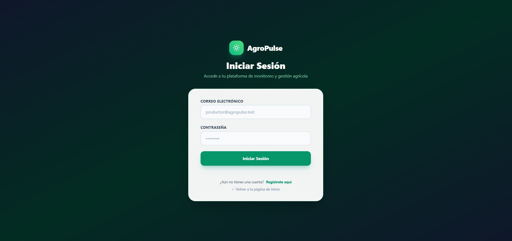
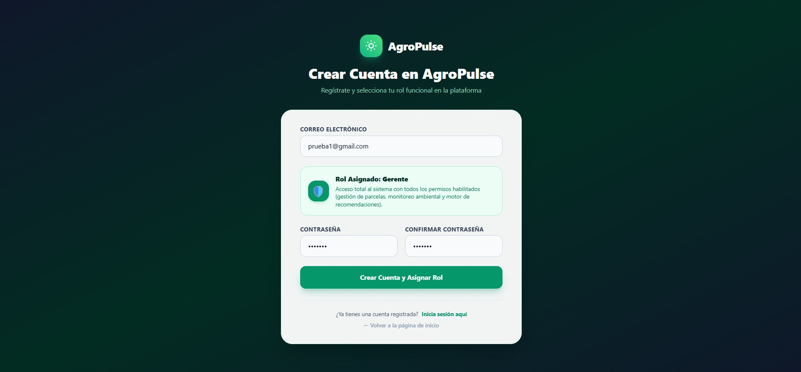
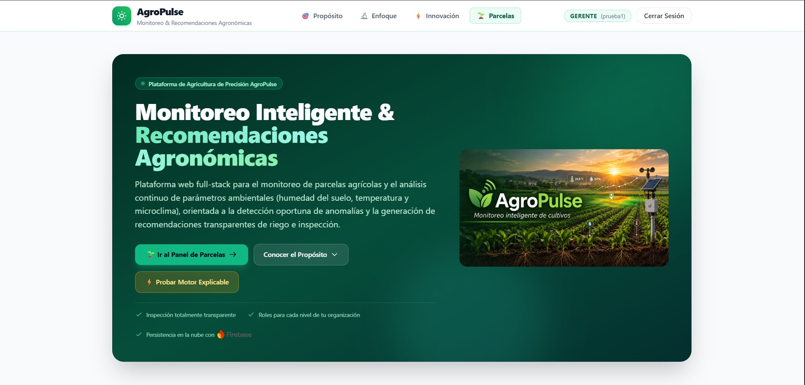
### catalogo de fincas
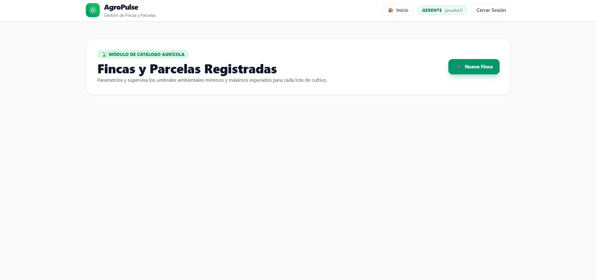
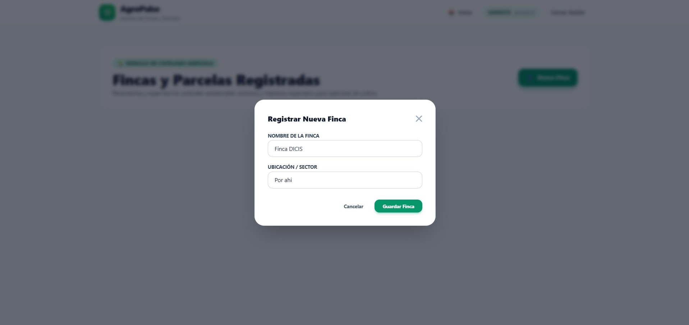
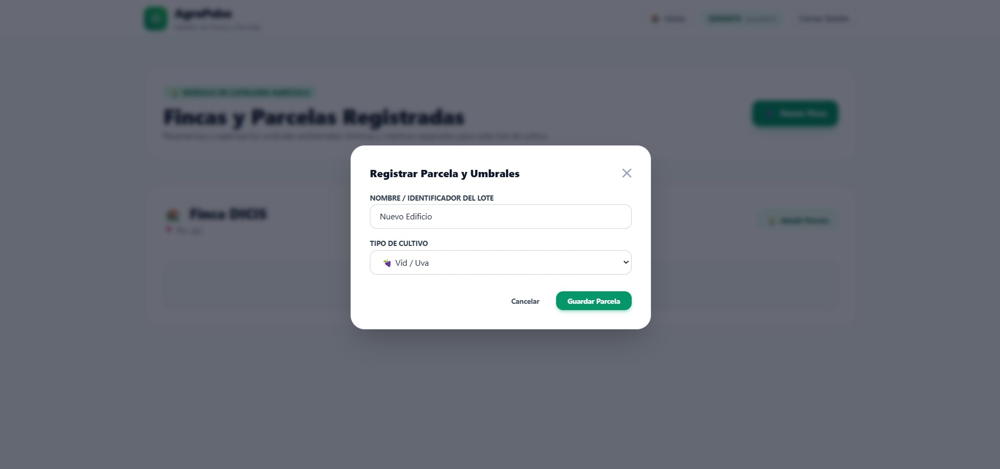
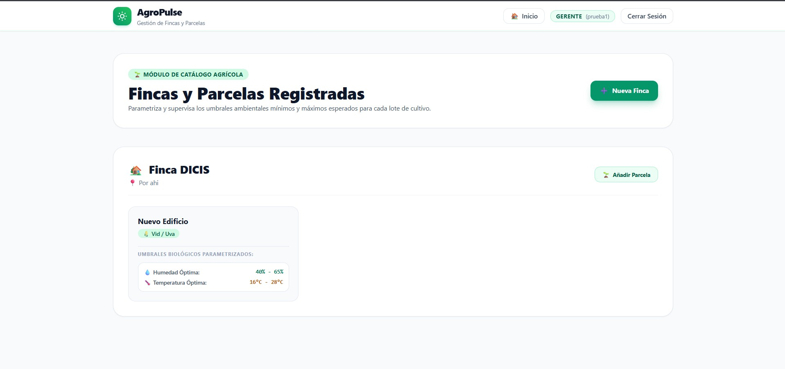

## Evidencias de ejecución: Rogelio

### pagina de inicio
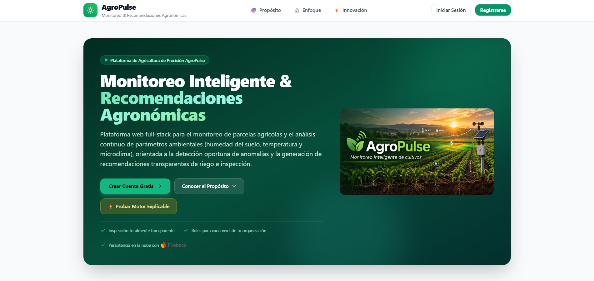
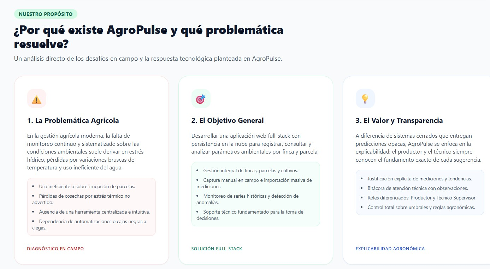
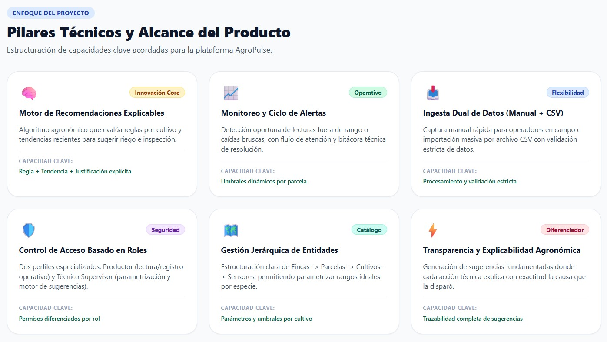
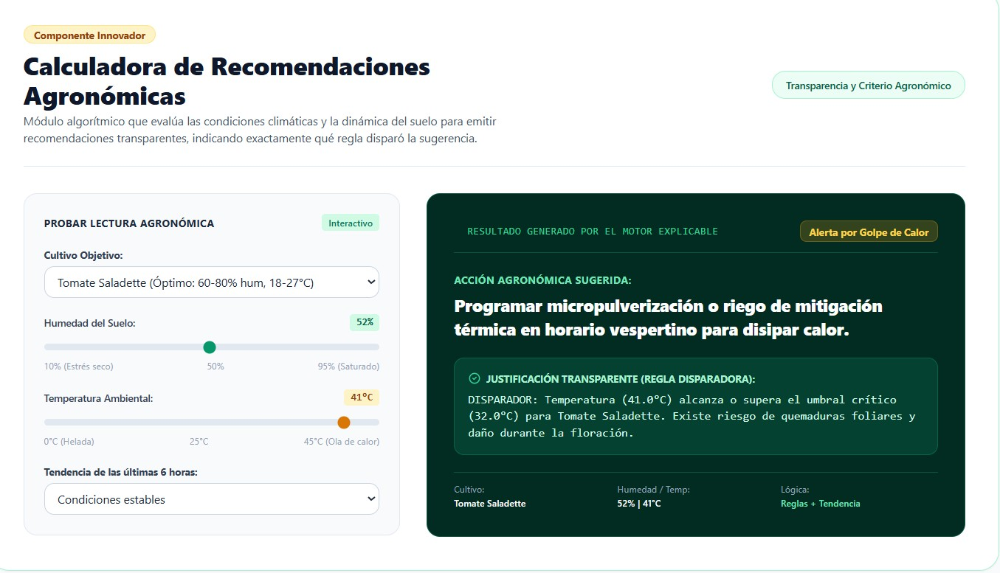
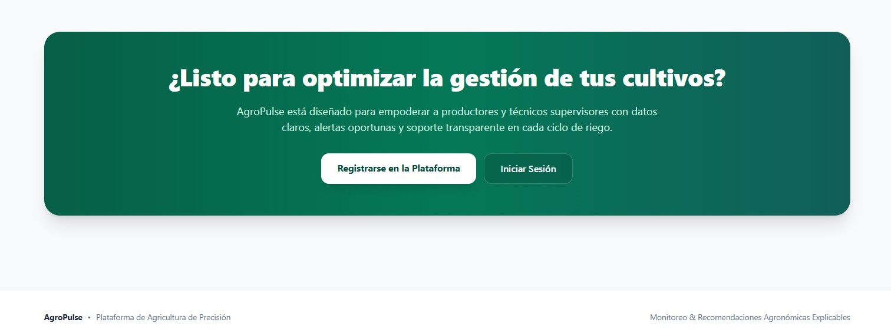

### mediciones
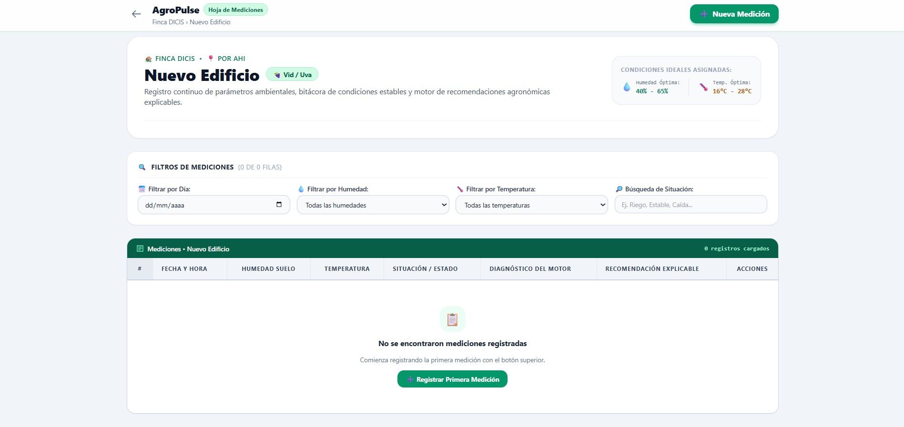
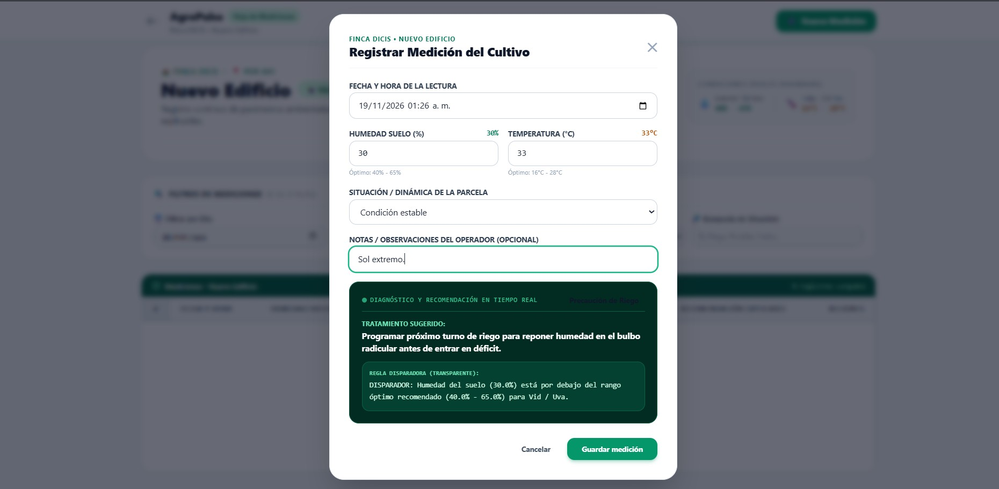
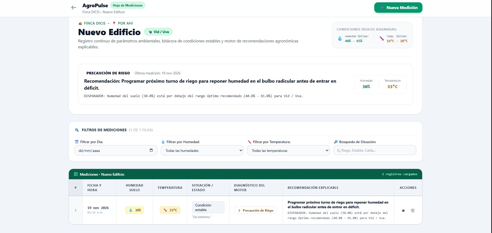

## Ramas Tzaphquiel:
- https://github.com/bolilloro61/AgroPulse/tree/feature/parcelas 
- https://github.com/bolilloro61/AgroPulse/tree/feature/loging

## Ramas Rogelio
- https://github.com/bolilloro61/AgroPulse/tree/feature/mediciones
- https://github.com/bolilloro61/AgroPulse/tree/feature/paginaprincipal